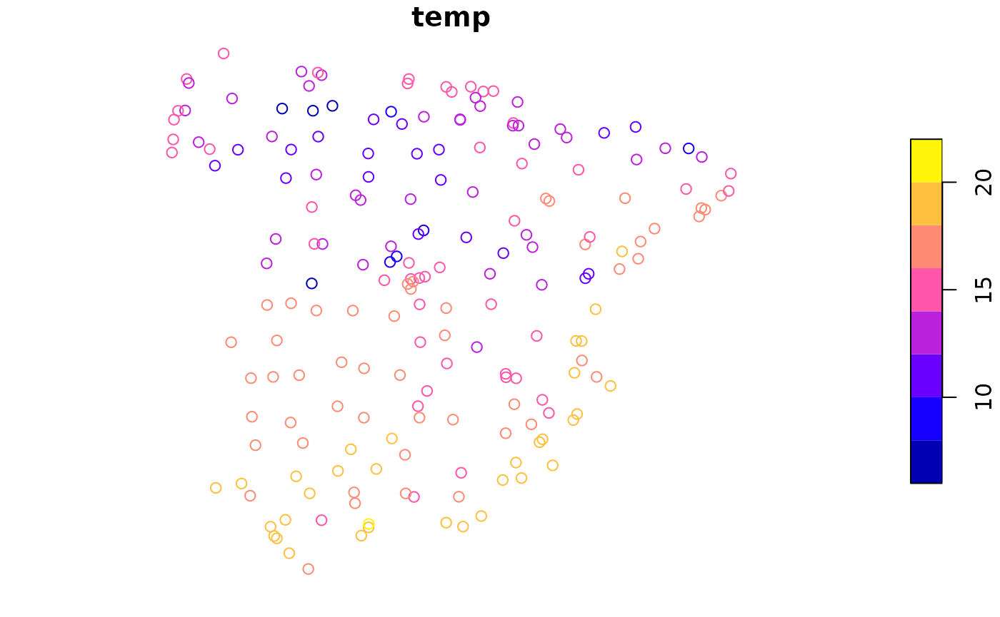
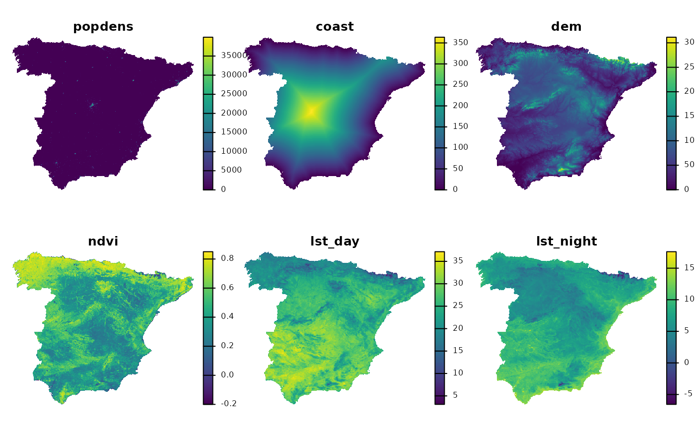
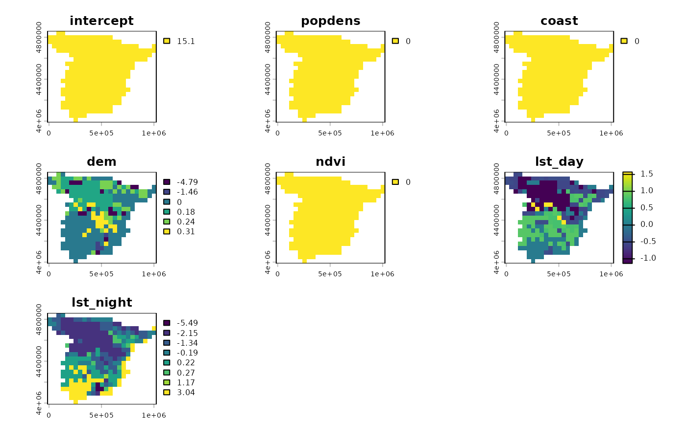
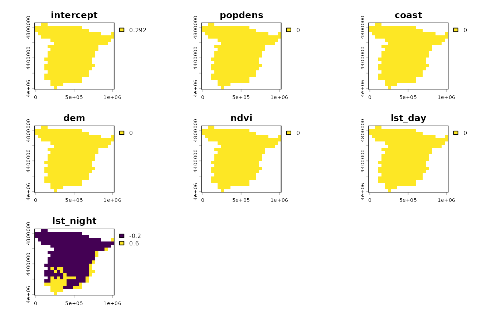

# An introduction to spatial explanations

The **spatialexplain** package provides model agnostic tools for
exploring and explaining spatial machine learning models. The goal of
this vignette is to show the basic workflow of its usage.[¹](#fn1)

Let’s start by attaching the necessary packages.

``` r
library(spatialexplain)
library(sf)
library(terra)
library(rpart)
library(DALEX)
```

Next, we load two spatial datasets. The first one is a spatial vector
point dataset with annual average air temperature measurements in
Celsius for Spain in 2019. The second one is a raster dataset with
predictors, such as population density (`popdens`), distance to the
coast (`coast`), elevation (`dem`), a satellite-based Normalized
Difference Vegetation Index (`ndvi`), and annual average composites of
the Land Surface Temperature product for day (`lst_day`) and night
(`lst_night`).

``` r
temp_train = read_sf("/vsicurl/https://github.com/Nowosad/IIIRqueR_workshop_materials/raw/refs/heads/main/data/temp_train.gpkg")
plot(temp_train)
```



``` r

predictors = rast("/vsicurl/https://github.com/Nowosad/IIIRqueR_workshop_materials/raw/refs/heads/main/data/predictors.tif")
plot(predictors, axes = FALSE)
```



## Data preparation

To prepare the data for the model, we need to extract the values of the
predictors at the locations of the temperature measurements with
[`extract()`](https://rspatial.github.io/terra/reference/extract.html),
and then combine them with the temperature measurements with
[`cbind()`](https://rdrr.io/r/base/cbind.html).

``` r
temp = extract(predictors, temp_train, ID = FALSE)
temp_train = cbind(temp_train, temp)
head(temp_train)
#> Simple feature collection with 6 features and 7 fields
#> Geometry type: POINT
#> Dimension:     XY
#> Bounding box:  xmin: 825940.4 ymin: 4541533 xmax: 934920.7 ymax: 4630234
#> Projected CRS: ED50 / UTM zone 30N
#>       temp      popdens      coast        dem      ndvi  lst_day lst_night
#> 1 17.52610     0.000000  1.1263009  85.905403 0.3656146 24.37792 12.642557
#> 2 16.94795     1.211701  6.7432733  75.001259 0.3990190 28.13341 10.706681
#> 3 17.49233     5.681698  1.7549587   2.556155 0.1987631 25.76198 11.370279
#> 4 15.30838  4752.076660 45.7688789 256.110870 0.3861388 26.97013  8.315234
#> 5 16.56247  1789.268799  6.2198448 303.596924 0.5917153 22.47704 12.101181
#> 6 17.22139 13260.116211  0.7378924  12.070770 0.2349442 24.79462 13.021243
#>                       geom
#> 1 POINT (825940.4 4541533)
#> 2 POINT (849548.2 4563427)
#> 3 POINT (924683.3 4583884)
#> 4 POINT (902776.4 4630234)
#> 5 POINT (928394.5 4598097)
#> 6 POINT (934920.7 4595391)
```

## Regression model

Now, we can build models that predict the temperature based on the
predictors. The first one is a regression model that predicts the
temperature in Celsius for the whole area of the `predictors` raster.
Many modeling methods and R tools can be used to build the model, but in
this vignette, we use the
[`rpart()`](https://rdrr.io/pkg/rpart/man/rpart.html) function from the
**rpart** package, which builds a regression tree model.

``` r
rpart_model = rpart(temp ~ ., data = st_drop_geometry(temp_train))
rpart_model
#> n= 195 
#> 
#> node), split, n, deviance, yval
#>       * denotes terminal node
#> 
#>  1) root 195 1546.773000 15.101570  
#>    2) lst_night< 7.545278 70  286.239700 12.218960  
#>      4) dem>=1271.976 9   15.529640  8.157678 *
#>      5) dem< 1271.976 61  100.362400 12.818160  
#>       10) lst_day< 27.41322 52   52.454960 12.469420  
#>         20) lst_night< 5.956942 35   21.516320 11.993630 *
#>         21) lst_night>=5.956942 17    6.703209 13.448980 *
#>       11) lst_day>=27.41322 9    5.042911 14.833110 *
#>    3) lst_night>=7.545278 125  353.141300 16.715830  
#>      6) lst_night< 10.0302 69   92.904980 15.557040  
#>       12) lst_day< 25.98267 24   13.758720 14.412790 *
#>       13) lst_day>=25.98267 45   30.963710 16.167310 *
#>      7) lst_night>=10.0302 56   53.423460 18.143620 *
```

Next, we can use the
[`explain()`](https://modeloriented.github.io/DALEX/reference/explain.html)
function from the **DALEX** package to create an explainer object for
the model. Explainer is a universal model wrapper that can be used to
explain any model with the same set of tools.[²](#fn2)

``` r
regr_exp = explain(rpart_model,
                   data = st_drop_geometry(temp_train)[-1],
                   y = temp_train$temp)
#> Preparation of a new explainer is initiated
#>   -> model label       :  rpart  (  default  )
#>   -> data              :  195  rows  6  cols 
#>   -> target variable   :  195  values 
#>   -> predict function  :  yhat.rpart  will be used (  default  )
#>   -> predicted values  :  No value for predict function target column. (  default  )
#>   -> model_info        :  package rpart , ver. 4.1.24 , task regression (  default  ) 
#>   -> predicted values  :  numerical, min =  8.157678 , mean =  15.10157 , max =  18.14362  
#>   -> residual function :  difference between y and yhat (  default  )
#>   -> residuals         :  numerical, min =  -3.09541 , mean =  1.512235e-15 , max =  2.473572  
#>   A new explainer has been created!
```

This explainer can be used to check various instance and dataset-level
explanations of the model, such as partial dependence plots and feature
importance.[³](#fn3) However, these methods usually do not inform us
about the spatial distribution of the model predictions. This is where
the **spatialexplain** package comes in. It has functions called
[`map_breakdown()`](../reference/map_breakdown.md),
[`map_shap()`](../reference/map_shap.md),
[`map_oscillations()`](../reference/map_oscillations.md), and
[`map_lime()`](../reference/map_lime.md) that can be used to calculate
the attributions of the model for each observation in the raster. These
functions require the explainer object and the predictor’s raster.
Additionally, as the calculation of the attributions can be
computationally expensive, the functions have a `maxcell` parameter that
controls the number of cells in the raster that will be used to get the
attributions.

``` r
regr_pps1 = map_breakdown(regr_exp, predictors, maxcell = 500)
plot(regr_pps1)
```



The [`map_breakdown()`](../reference/map_breakdown.md) function
calculates the Break Down attributions. This method quantifies how each
explanatory variable contributes to the model’s average prediction (the
‘intercept’) by assessing the impact on the prediction as values of each
variable are fixed in sequence. Each of the cells in the raster is
colored according to the contribution of the predictors to the model
prediction. Here, we can see that the intercept of the model is 15.1 for
the whole area, and that the variables `popdens`, `coast`, and `ndvi` do
not have any influence on the model prediction. On the other hand, the
variables `dem`, `lst_day`, and `lst_night` affect the model prediction
differently, depending on the location. For example, the `dem` variable
has a negative influence on the model prediction in the mountainous
areas – the higher the elevation, the lower the temperature.

## Classification model

The same workflow can be used for classification models. Here, we build
a classification model that predicts if the temperature is cold or hot
(below or above 17 degrees Celsius).

``` r
temp_train$temp = cut(temp_train$temp,
                      breaks = c(-Inf, 17, Inf), labels = c("cold", "hot"))
```

We use the [`rpart()`](https://rdrr.io/pkg/rpart/man/rpart.html)
function from the **rpart** package to build a classification tree
model.

``` r
rpart_model_clas = rpart(temp ~ ., data = st_drop_geometry(temp_train))
rpart_model_clas
#> n= 195 
#> 
#> node), split, n, loss, yval, (yprob)
#>       * denotes terminal node
#> 
#> 1) root 195 57 cold (0.70769231 0.29230769)  
#>   2) lst_night< 10.04327 140  8 cold (0.94285714 0.05714286) *
#>   3) lst_night>=10.04327 55  6 hot (0.10909091 0.89090909) *
```

Next, we create an explainer object for the classification model – the
code is almost the same as for the regression model, except that we use
the classification model here.

``` r
clas_exp = explain(rpart_model_clas,
                   data = st_drop_geometry(temp_train)[-1],
                   y = temp_train$temp)
#> Preparation of a new explainer is initiated
#>   -> model label       :  rpart  (  default  )
#>   -> data              :  195  rows  6  cols 
#>   -> target variable   :  195  values 
#>   -> predict function  :  yhat.rpart  will be used (  default  )
#>   -> predicted values  :  No value for predict function target column. (  default  )
#>   -> model_info        :  package rpart , ver. 4.1.24 , task classification (  default  ) 
#>   -> model_info        :  Model info detected classification task but 'y' is a factor .  (  WARNING  )
#>   -> model_info        :  By deafult classification tasks supports only numercical 'y' parameter. 
#>   -> model_info        :  Consider changing to numerical vector with 0 and 1 values.
#>   -> model_info        :  Otherwise I will not be able to calculate residuals or loss function.
#>   -> predicted values  :  numerical, min =  0.05714286 , mean =  0.2923077 , max =  0.8909091  
#>   -> residual function :  difference between y and yhat (  default  )
#> Warning in Ops.factor(y, predict_function(model, data)): '-' not meaningful for
#> factors
#>   -> residuals         :  numerical, min =  NA , mean =  NA , max =  NA  
#>   A new explainer has been created!
```

Finally, we can calculate the attributions for the classification model
using the [`map_breakdown()`](../reference/map_breakdown.md) function.

``` r
clas_pps1 = map_breakdown(clas_exp, predictors, maxcell = 500)
plot(clas_pps1)
```



The classification model is much simpler in this case.[⁴](#fn4) The
average prediction of the model is `0.292` for the whole area, meaning
that the probability of the temperature being hot is `0.292`. Then, only
the `lst_night` variable has an impact on the model prediction, with the
higher values of the variable increasing the probability of the
temperature being hot. We can find such areas in the south of Spain and
along its eastern coast.

------------------------------------------------------------------------

1.  The modeling part of the vignette is very simplified to focus on the
    **spatialexplain** package capabilities.

2.  The **DALEX** package allows explaining models created with
    **keras**, **parsnip**, **caret**, **mlr**, **H2O**, **xgboost**,
    and many others. Moreover, its extension **DALEXtra** allows
    explaining models created with **xgboost**, **mlr**, **mlr3**,
    **tidymodels**, and even Python’s **scikit-learn** and **keras** and
    Java’s **h2o**.

3.  Read the [“Biecek, P., & Burzykowski, T. (2021). Explanatory model
    analysis: explore, explain, and examine predictive models. Chapman
    and Hall/CRC.](https://ema.drwhy.ai/) book for more details.

4.  Importantly, we did not consider the quality of the models in this
    vignette. In the real-world scenario, the model should be validated
    using cross-validation, and the quality of the model should be
    assessed using various metrics.
