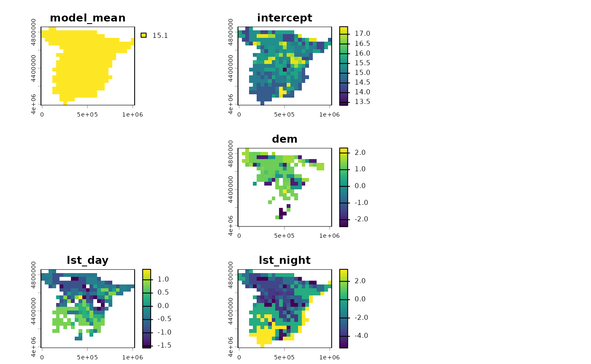
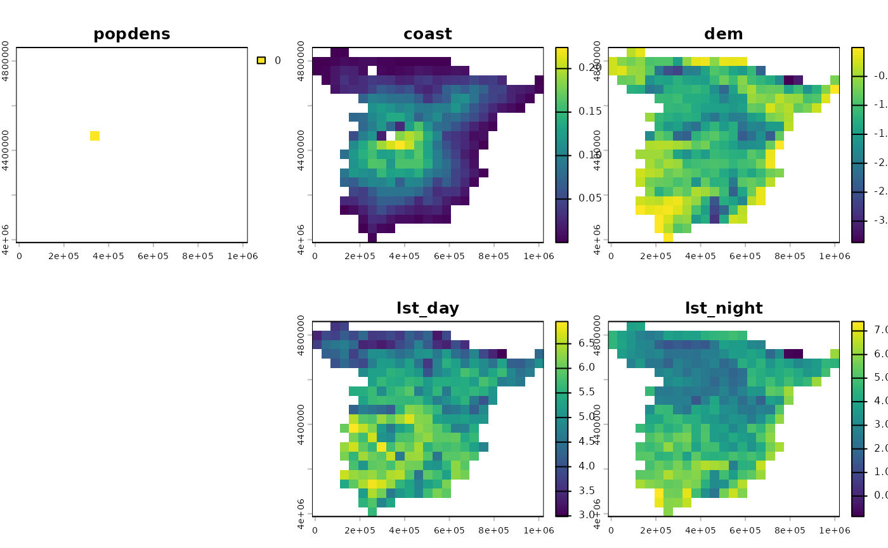

# Spatial LIME

The **spatialexplain** package provides model agnostic tools for
exploring and explaining spatial machine learning models. This vignette
shows a simple example of how to use it to explain a regression model
with a few implementations of the Local Interpretable Model-agnostic
Explanations (LIME) method.

Let’s start by attaching the necessary packages, reading the predictors
raster, and loading the pre-trained regression model.

``` r
# attaching the necessary packages
library(spatialexplain)
library(terra)

# reading the predictors raster
predictors = rast("/vsicurl/https://github.com/Nowosad/IIIRqueR_workshop_materials/raw/refs/heads/main/data/predictors.tif")
plot(predictors, axes = FALSE)
```


``` r

# loading the pre-trained regression model
data("regr_exp", package = "spatialexplain")
regr_exp
#> Model label:  rpart 
#> Model class:  rpart 
#> Data head  :
#>    popdens    coast      dem      ndvi  lst_day lst_night
#> 1 0.000000 1.126301 85.90540 0.3656146 24.37792  12.64256
#> 2 1.211701 6.743273 75.00126 0.3990190 28.13341  10.70668
```

The `regr_exp` object is a pre-trained regression model that was trained
on the predictors raster.

The main idea behind the LIME method is to approximate the complex model
with a simpler one that is easier to interpret. The
[`map_lime()`](../reference/map_lime.md) function explains the model
using one of three implementations of the LIME method:
`type = "localModel"`, `type = "iml"`, and `type = "lime"`.

The default one is the `"localModel"` method.

``` r
regr_lime1 = map_lime(regr_exp, predictors, maxcell = 500, type = "localModel")
plot(regr_lime1)
```



The second one is the `"iml"` method[¹](#fn1).

``` r
regr_lime2 = map_lime(regr_exp, predictors, maxcell = 500, type = "iml")
#> Warning in private$aggregate(): Had to choose a smaller k
plot(regr_lime2)
```



The last one is the `"lime"` method; however, currently, it only works
for explainers created with one of the supported models/modeling
framework (e.g., **ranger** or **caret**).

``` r
regr_lime3 = map_lime(regr_exp, predictors, maxcell = 500, type = "lime")
```

These different implementations use other algorithms to extract the
interpretable features, have other sampling methods, and other ways of
weighting. For more explanation of the LIME method, read the [“Local
Interpretable Model-agnostic Explanations
(LIME)”](https://ema.drwhy.ai/LIME.html) chapter from the [Explanatory
Model Analysis](https://ema.drwhy.ai/) book.

------------------------------------------------------------------------

1.  It requires the **iml** package to be installed.
