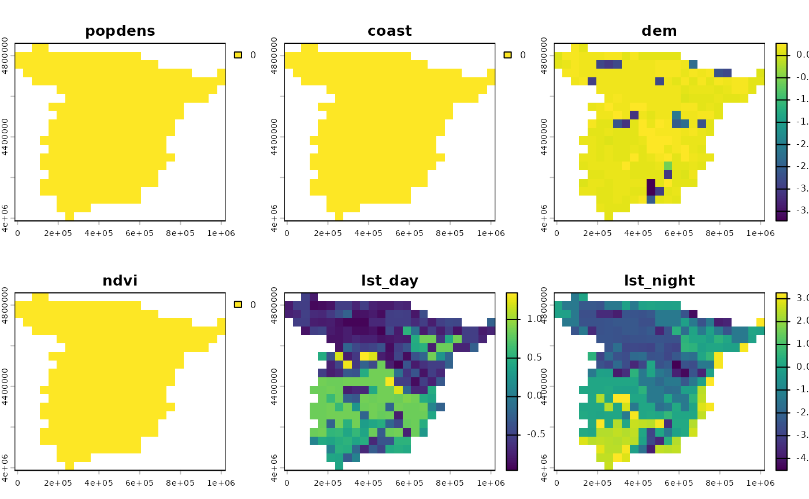

# Spatial SHAP

The **spatialexplain** package provides model agnostic tools for
exploring and explaining spatial machine learning models. This vignette
shows a simple example of how to use it to explain a regression model
with the SHAP method.

Lets start by attaching the necessary packages, reading the predictors
raster, and loading the pre-trained regression model.

``` r
# attaching the necessary packages
library(spatialexplain)
library(terra)

# reading the predictors raster
predictors = rast("/vsicurl/https://github.com/Nowosad/IIIRqueR_workshop_materials/raw/refs/heads/main/data/predictors.tif")
plot(predictors, axes = FALSE)
```


``` r

# loading the pre-trained regression model
data("regr_exp", package = "spatialexplain")
regr_exp
#> Model label:  rpart 
#> Model class:  rpart 
#> Data head  :
#>    popdens    coast      dem      ndvi  lst_day lst_night
#> 1 0.000000 1.126301 85.90540 0.3656146 24.37792  12.64256
#> 2 1.211701 6.743273 75.00126 0.3990190 28.13341  10.70668
```

The SHAP method is a model-agnostic method that explains the model’s
predictions by attributing the prediction to each feature. However, as
compared to the Break Down method, the SHAP method uses the idea of
averaging the value of a variable’s attribution over all or many
possible orderings. This has two main implications: the SHAP method is
computationally more expensive, but its results are less sensitive to
the order of the variables. This method provides additive feature
attribution – thus, it works best for additive models (e.g., linear
regression), and if the model is not additive, the SHAP values may not
be meaningful.

We can use the [`map_shap()`](../reference/map_shap.md) function to
explain the regression model using the SHAP method.

``` r
regr_psp_shap = map_shap(regr_exp, predictors, maxcell = 500)
plot(regr_psp_shap)
```



The resulting maps show that the `popdens`, `coast`, and `ndvi`
variables had no effect on the model’s predictions. The `dem` variable
mostly influenced the results in the mountainous areas, while `lst_day`
and `lst_night` had different effects for the south and north parts of
Spain.

For more explanation of the SHAP method, read the [“Shapley Additive
Explanations (SHAP) for Average
Attributions”](https://ema.drwhy.ai/shapley.html) chapter from the
[Explanatory Model Analysis](https://ema.drwhy.ai/) book.
