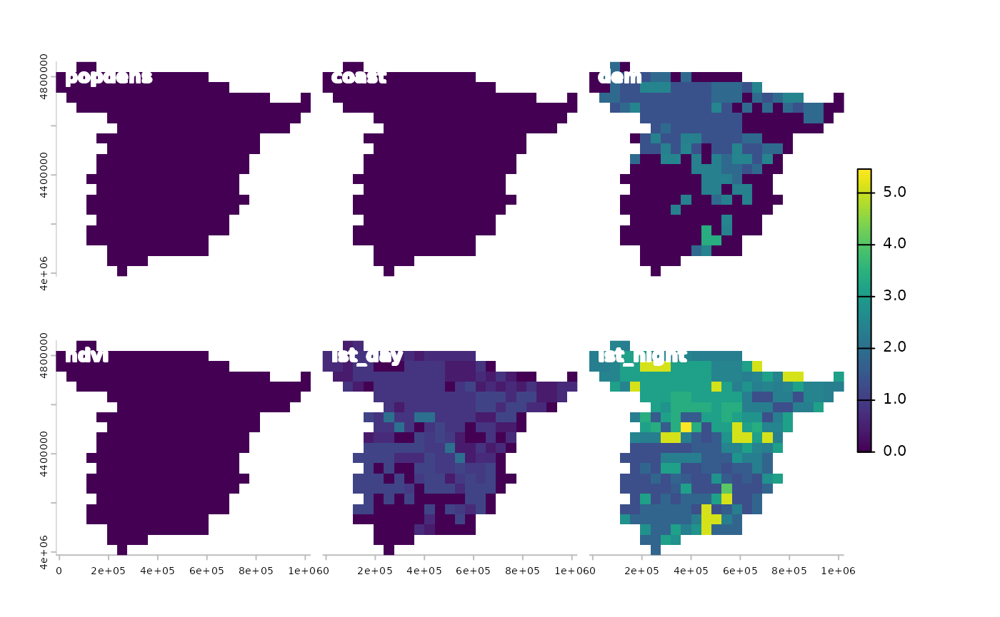
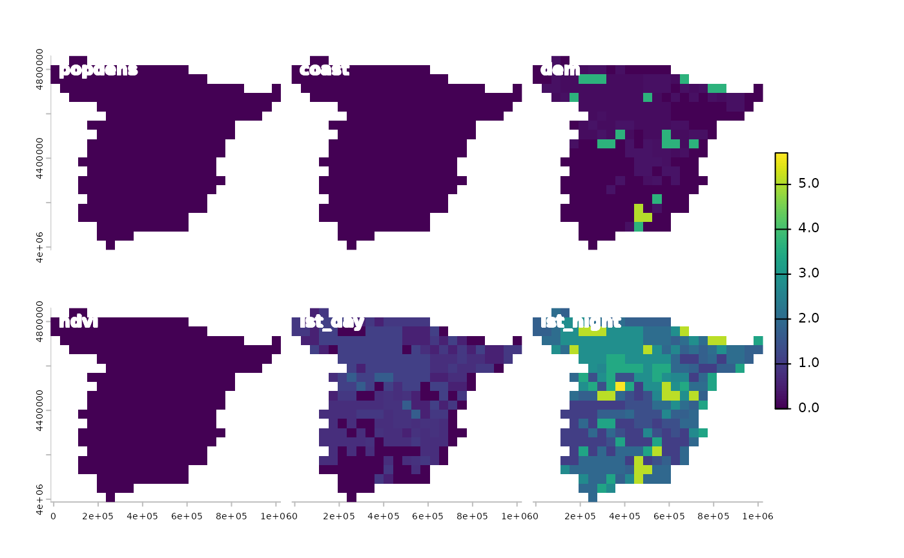

# Spatial oscillations

The **spatialexplain** package provides model agnostic tools for
exploring and explaining spatial machine learning models. This vignette
shows a simple example of how to use it to explain a regression model
with the oscillations method.

Let’s start by attaching the necessary packages, reading the predictors
raster, and loading the pre-trained regression model.

``` r
# attaching the necessary packages
library(spatialexplain)
library(terra)

# reading the predictors raster
predictors = rast("/vsicurl/https://github.com/Nowosad/IIIRqueR_workshop_materials/raw/refs/heads/main/data/predictors.tif")
plot(predictors, axes = FALSE)
```


``` r

# loading the pre-trained regression model
data("regr_exp", package = "spatialexplain")
regr_exp
#> Model label:  rpart 
#> Model class:  rpart 
#> Data head  :
#>    popdens    coast      dem      ndvi  lst_day lst_night
#> 1 0.000000 1.126301 85.90540 0.3656146 24.37792  12.64256
#> 2 1.211701 6.743273 75.00126 0.3990190 28.13341  10.70668
```

The Oscillations method quantifies how sensitive the model response is
for each predictor. For variables that strongly influence a model’s
prediction, the outcomes will show large oscillations, and for variables
with little or no influence, the oscillations will be small or
non-existent.

Now, we can use the
[`map_oscillations()`](../reference/map_oscillations.md) function to
explain the regression model using the Oscillations methods. Three types
of the Oscillations method are available: `oscillations_uni`,
`oscillations_emp`, and `oscillations`. The first one is the simplest
and the fastest, so it may be preferred for quick exploration. The
second one uses the empirical distributions of the predictors, and thus
it is better for cases when there is enough data to estimate such
distributions. The third one, `oscillations`, aims at more advanced
cases in which the user specifies a pre-defined grid of values for
continuous predictors; thus, it may not be the most useful for raster
explainability, and we are not going to use it here.

``` r
# oscillations_uni
regr_psp_osu = map_oscillations(regr_exp, predictors, maxcell = 500,
                                     type = "oscillations_uni")
panel(regr_psp_osu, col.main = "white")
```



``` r

# oscillations_emp
regr_psp_ose = map_oscillations(regr_exp, predictors, maxcell = 500,
                                     type = "oscillations_emp")
panel(regr_psp_ose, col.main = "white")
```



In this case, both the `oscillations_uni` and `oscillations_emp` methods
give similar results, suggesting the most importance of the `lst_night`
variable, followed by `lst_day` and `dem`. At the same time, we may
notice that some areas have higher sensitivity to the `lst_night`
variable (e.g., northern Spain), while others have lower sensitivity
(e.g., southern Spain).

Similarly to most other explanation methods, the Oscillations methods
are sensitive to the correlation or interactions between the predictors.
For more explanation of the Oscillations methods, read the
[“Ceteris-paribus
Oscillations”](https://ema.drwhy.ai/ceterisParibusOscillations.html)
chapter from the [Explanatory Model Analysis](https://ema.drwhy.ai/)
book.
